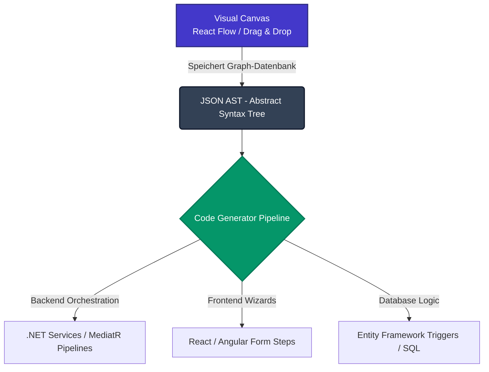

# 📋 TODO-Liste & Workflow-Architektur: Phase "Diagramme & Workflows"

Diese Dokumentation definiert die Blaupause und die Entwicklungsschritte für das nächste große Feature unserer RAD-Engine: **Visuelle Workflows und Datenbank-Diagramme (ERD)**. 

---

## 🏗 System-Architektur für Workflows

Das folgende Diagramm zeigt den Datenfluss vom visuellen Editor bis zum generierten, nativen Business-Code.

---

## ✅ Checkliste: Implementierungs-Phasen

### Phase 1: Die Benutzeroberfläche (Visueller Editor)
- [x] **Canvas-Library integrieren:** Evaluierung und Einbau von (z. B.) *React Flow* für eine flüssige Drag & Drop Umgebung.
- [x] **Ribbon-Tabs erweitern:** Neue Reiter `Workflows` und `ER-Diagramm` im oberen Menüband hinzufügen.
- [x] **Workspace-Layout bauen:**
    - [x] **Toolbox (Links):** Panel mit verfügbaren Nodes (Start, Aktion, Bedingung, Schleife).
    - [x] **Properties Panel (Rechts):** Konfigurationsmenü für den jeweils ausgewählten Node (z.B. API-Endpoint-URL für eine Aktion).
    - [x] **Minimap & Controls:** Zoom und Pan-Features im Canvas.

### Phase 2: Workflow-Logik & Node-Typen
- [x] **Datenmodell definieren:** Zustand (Zustand der Nodes und Kanten) sicher im lokalen Storage oder Redux/Zustand ablegen.
- [x] **Spezifische Nodes entwickeln:**
    - [x] `Trigger-Node`: Was löst den Flow aus? (API-Route, CRON-Job, Button-Click)
    - [x] `Action-Node`: Was wird gemacht? (E-Mail senden, Datenbank-Record anlegen)
    - [x] `Condition-Node` (Gateway): IF/ELSE Weichen (Bedingungen prüfen)
    - [x] `End-Node`: Rückgabe (Erfolg, Fehler, Response Payload)

### Phase 3: ER-Diagramme (Entity Relationship)
- [x] **Auto-Layout Modul:** Tabellen aus dem bestehenden JSON-Schema automatisch visuell auf einem Canvas anordnen (Entity-Boxen mit Foreign-Key-Linien).
- [x] **Two-Way Binding:** Wenn eine Tabelle oder Spalte im visuellen Diagramm bearbeitet wird, aktualisiert sich sofort das Datenmodell (und umgekehrt).

### Phase 4: Generator-Logik (Die Magie)
- [x] **Topologische Sortierung (AST):** Den visuellen Graphen (Punkte und Linien) in einen linearen, logischen Code-Ablaufbaum umwandeln.
- [x] **Backend-Code Generierung (.NET/Node):**
    - Umwandlung der Workflow-Bäume in echte C#/TypeScript Service-Klassen.
    - Übersetzung der `Condition-Nodes` in standardmäßige IF/ELSE oder Switch-Statements.
- [x] **Frontend-Code Generierung:** Erstellung von passenden "Wizard"-Komponenten, wenn ein Workflow mehrere Frontend-Schritte abverlangt (z.B. Multi-Step-Forms).

---

## 🚀 Wie wir starten:

Um zu beginnen, schnappen wir uns in der nächsten Session **Phase 1** und installieren das Grundgerüst für den Graph-Editor und erweitern unser Ribbon-Menü um die dazugehörigen Tabs.
